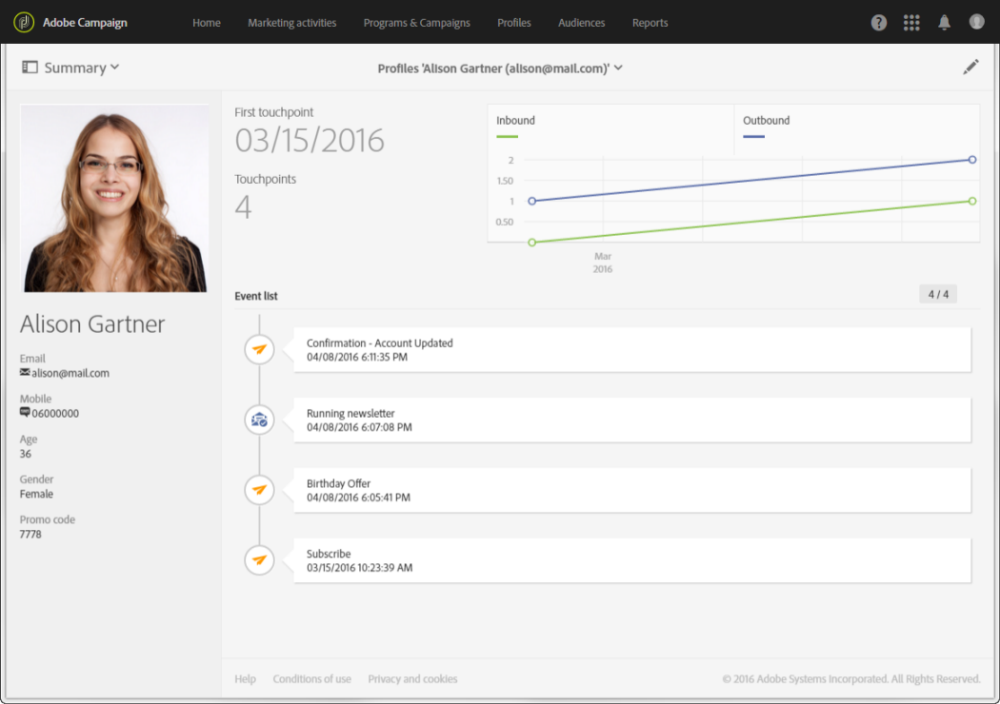

# 關於輪廓{#about-profiles}

Adobe Campaign可讓您在連絡人的整個生命週期對其進行管理：建立、匯入、目標定位、動作追蹤、更新等。聯絡人儲存在資料庫中，作為包含連結至他們的資訊的設定檔：姓氏、名字、地址、訂閱、傳送等。

>[!NOTE]
>
>您也可以使用 Adobe Campaign Standard API 取得輪廓。 如需詳細資訊，請參閱[專屬文件](../../api/using/retrieving-profiles.md)。

當您建立行銷活動時，您可以根據簡單或進階標準選取輪廓，以定義傳送的目標。 就技術方面而言，輪廓是資料庫中包含目標選擇、確認和追蹤行為所需的所有資訊的項目。

輪廓可以是：客戶、潛在客戶、訂閱電子報的個人、收件者、使用者或任何其他面額 (視您的組織而定)。 若要定義各種輪廓類型，請使用[目標維度](../../automating/using/query.md#targeting-dimensions-and-resources)。
