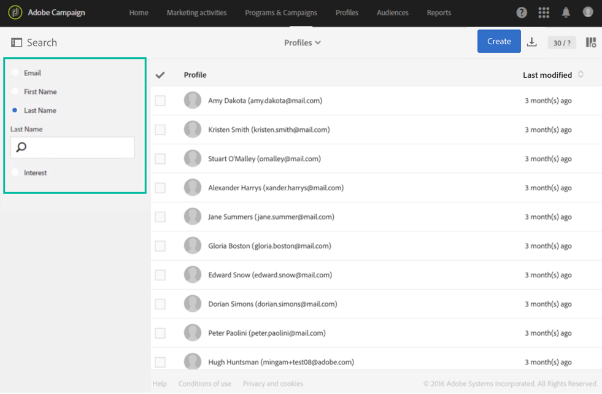

# 整合式客戶輪廓{#integrated-customer-profile}

資料庫的每個聯絡人都可以使用整合式客戶輪廓。 此行銷記錄將所有與客戶聯絡相關的行銷資訊結合為單一檢視。 之後，您可以在一個集中位置存取所有數位行為、線上和離線交易：聯絡資訊、收到的電子郵件、追蹤記錄、訂閱和取消訂閱等。

若要存取整合式客戶輪廓，請執行以下步驟：

1. 從Adobe Campaign首頁，按一下「**[!UICONTROL Customer profiles]**」卡片或「**設定檔**」標籤，以顯示設定檔清單。

1. 若要根據特定欄位搜尋設定檔，請開啟搜尋窗格，然後選取您要執行搜尋的欄位。

   

1. 指定要搜尋的值，然後按Enter鍵。

   >[!NOTE]
   >
   >請注意，可以根據電子郵件、名字和姓氏欄位，以及在擴充資源時新增的自訂欄位來執行搜尋。
   >
   >搜尋會區分大小寫，且僅會在首碼上執行。 例如，您將無法使用設定檔的姓氏來查詢設定檔。

1. 選取連絡人以開啟其設定檔。

   

之後，您可以存取此連絡人的&#x200B;**行銷記錄**。

此頁面會收集關於輪廓的重要資訊及事件清單。

按一下清單中的事件以開啟它：您可以存取已傳送的訊息或設定檔已訂閱的服務。

>[!NOTE]
>
>您也可以使用 Adobe Campaign Standard API 存取行銷記錄。 如需詳細資訊，請參閱[專屬文件](../../api/using/interacting-with-marketing-history.md)。
