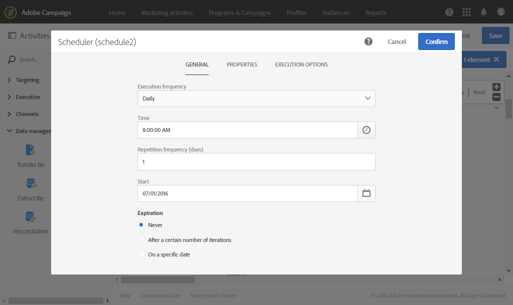

# 生日傳遞 {#birthday-delivery}

此範例是生日工作流程。 每天都會傳送電子郵件給當天生日的設定檔。

若要建置工作流程，請遵循下列步驟：

* [排程器](../../automating/using/scheduler.md)可讓您每天上午8點啟動工作流程。

  

* [查詢](../../automating/using/query.md)活動可讓您計算每次執行工作流程時，提供電子郵件的設定檔及其生日。 生日計算是使用查詢編輯工具浮動視窗中可用的預先定義篩選器來執行。

  

* [電子郵件傳遞](../../automating/using/email-delivery.md)是週期性的。 傳送會依月份匯總。 所以，在一個月內傳送的所有電子郵件都會彙總成單一檢視。 因此，在一年內，會執行 365 個傳送，但會在 Adobe Campaign 介面中重新分組為 12 個檢視（也稱為 **recurring executions**)。 歷史記錄和報表詳細資訊會每個月顯示一次，而非每次傳送。

  
