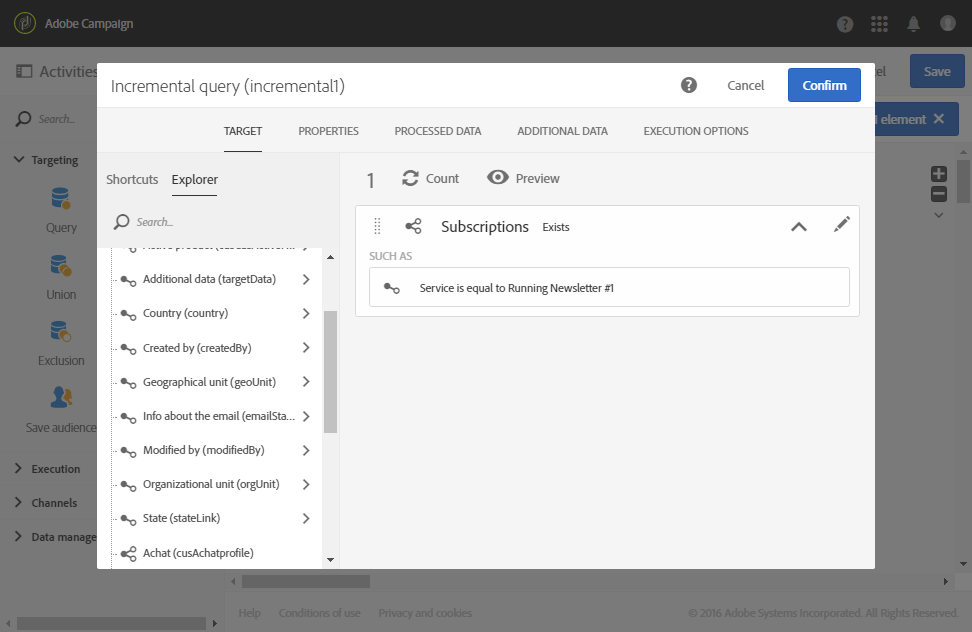

# 對服務訂閱者的增量查詢 {#example--incremental-query-on-subscribers-to-a-service}

下列範例顯示 **[!UICONTROL Incremental query]** 活動的設定，該活動會篩選訂閱 **Running Newsletter** 服務之 Adobe Campaign 資料庫中的輪廓，以傳送包含促銷代碼的歡迎電子郵件給他們。

工作流程由下列元素組成：

* [排程器](../../automating/using/scheduler.md)活動，每週一早上6:00執行工作流程。

  

* [增量查詢](../../automating/using/incremental-query.md)活動，在第一次執行期間鎖定所有目前訂閱者，然後在下列執行期間只鎖定該周的新訂閱者。

  

* [電子郵件傳遞](../../automating/using/email-delivery.md)活動。 工作流程每週執行一次，但您可以彙總所傳送的電子郵件和每月結果，例如產生整個月（而不只是一週）的報表。

  要執行此操作，請選取在這裡建立 **[!UICONTROL Recurring email]** 重新分組電子郵件和結果 **[!UICONTROL By month]**。

  定義電子郵件的內容並插入歡迎促銷代碼。 如需詳細資訊，請參閱[定義電子郵件內容](../../designing/using/personalization.md)區段。

然後開始執行工作流程。 每週新訂閱者都會收到包含促銷代碼的歡迎電子郵件。
