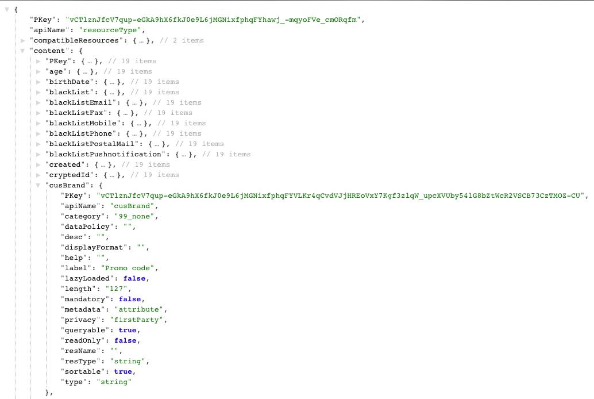

# 步驟 3：驗證擴充{#step-verify-the-extension}

1. 對Profiles &amp; Services擴充功能API的中繼資料執行GET作業，檢查現在是否可使用Profiles自訂資源中新增的欄位。

   ```
   GET profileAndServicesExt/resourceType/profile
   ```

1. 它會傳回：

   

   此欄位現在可用於進一步開發和整合。
