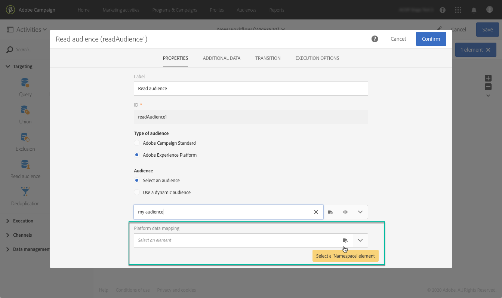
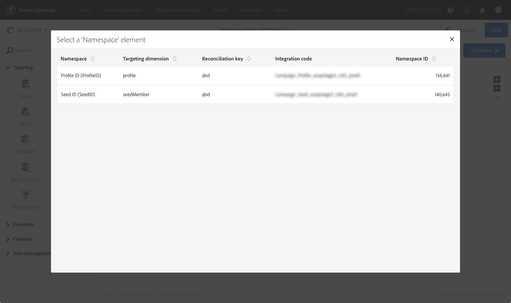
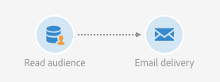

# 目標定位 Adobe Experience Platform 客群 {#targeting-aep-audiences}

>[!IMPORTANT]
>
>Audience Destinations服務目前為測試版，可能會經常更新，恕不另行通知。 客戶必須在Azure上託管（目前僅限北美地區使用Beta版）才能存取這些功能。 如果您想要存取，請聯絡Adobe客戶服務。

使用區段產生器建立[Adobe Experience Platform對象](../../integrating/using/aep-about-audience-destinations-service.md)後，您可以使用相同的方式在工作流程中的行銷活動對象使用它，以個人化和傳送訊息。

若要在工作流程中啟用Adobe Experience Platform對象，請遵循下列步驟：

1. 將&#x200B;**[!UICONTROL Read audience]**&#x200B;活動新增至工作流程，然後開啟它。

1. 選取「**[!UICONTROL Type of audience]**」下的「**[!UICONTROL Adobe Experience Platform]**」選項，然後新增所需的對象。

   

1. （可選）選取對象後，您可以按一下眼睛按鈕以檢閱及/或編輯區段定義（請務必再次儲存變更）。

   按一下眼睛按鈕只會將您導向與Campaign內所選對象相關聯的區段產生器（在另一個標籤中）。

1. 選取&#x200B;**[!UICONTROL Platform data mapping]**&#x200B;元素，針對選取的Adobe Experience Platform對象指定所需的目標維度。

   根據預設，用於調解的主索引鍵（例如，設定檔表格的iRecipientID、AppSubscription表格的iAppSubscriptionID）將自動從下拉式清單中取得。 若要在主索引鍵之外鎖定目標，您必須建立自訂&#x200B;**名稱空間**。

   >[!NOTE]
   >
   >對於主索引鍵以外的目標，您也必須建立與自訂名稱空間對應的自訂目標對應。 如需目標對應的詳細資訊，請參閱[本節](../../administration/using/target-mappings-in-campaign.md)。

   

   此清單包含已在您的執行個體上設定的所有Experience Data Model (XDM)對應。 如需Adobe Experience Platform Data Connector的詳細資訊，請參閱[此專屬檔案](../../integrating/using/aep-about-data-connector.md)。

   

1. 在對象和目標維度正確設定後，按一下&#x200B;**[!UICONTROL Confirm]**&#x200B;按鈕以儲存變更。

您現在可以使用其他活動來設定工作流程。 例如，您可以連結&#x200B;**[!UICONTROL Email delivery]**&#x200B;活動，以傳送電子郵件給已選取的對象。

>[!NOTE]
>
>Campaign Standard可讓您在所有傳遞管道內鎖定Adobe Experience Platform對象：電子郵件、簡訊、直接郵件訊息、推播通知和應用程式內訊息。
>
>*注意：對於所有推播和應用程式內訊息，Campaign Standard僅支援已知設定檔的傳送。

如需如何使用工作流程與傳送的詳細資訊，請參閱下列章節：

* [探索工作流程](../../automating/using/get-started-workflows.md)
* [建立工作流程](../../automating/using/building-a-workflow.md)
* [探索通訊頻道](../../channels/using/get-started-communication-channels.md)
* [關於頻道活動](../../automating/using/about-channel-activities.md)
