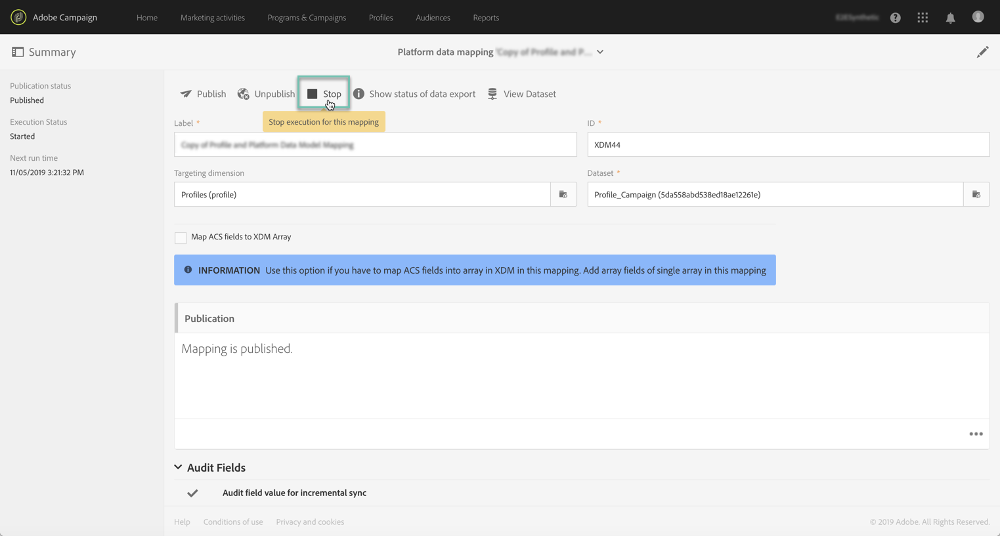

# 透過 API 觸發資料引入 {#triggering-data-ingestion-apis}

>[!IMPORTANT]
>
>Adobe Experience Platform Data Connector目前為測試版，可能會經常更新，恕不另行通知。 客戶必須在Azure上託管（目前僅限北美地區使用Beta版）才能存取這些功能。 如果您想要存取，請聯絡Adobe客戶服務。

Adobe Campaign Standard可讓您透過API觸發立即擷取資料對應，並擷取擷取要求的狀態。

此頁面說明如何觸發及擷取資料對應的擷取狀態。 如需Campaign Standard API的全球資訊，請參閱[本節](../../api/using/get-started-apis.md)。

## 先決條件 {#prerequisites}

必須先在Campaign Standard介面中設定並發佈資料對應，才能使用API。 如需詳細資訊，請參閱下列區段。

* [對應定義](../../integrating/using/aep-mapping-definition.md)
* [對應啟動](../../integrating/using/aep-mapping-activation.md)

建立資料對應後，您必須將其停止執行，以便您隨時可以從API觸發。 要執行此操作，請依照下列步驟執行：

1. 在Campaign Standard中，前往&#x200B;**[!UICONTROL Administration]** > **[!UICONTROL Development]** > **[!UICONTROL Platform]** > **[!UICONTROL Status of data export to platform]**&#x200B;功能表。

1. 連按兩下資料對應以開啟它，然後按一下&#x200B;**[!UICONTROL Stop]**&#x200B;按鈕。

   

1. 儲存您的變更

資料對應執行現已停止。 您可以使用Campaign Standard API手動觸發。

## 開始立即擷取資料對應 {#starting-immediate-ingestion}

透過POST操作觸發將XDM對應立即擷取到Adobe Experience Platform：

`POST https://mc.adobe.io/<ORGANIZATION>/campaign/dataIngestion/xdmIngestion/<XDM Mapping ID>/ingest`

>[!NOTE]
>
>為了執行內嵌POST API呼叫，使用者必須擁有&#x200B;**SQL函式執行**&#x200B;角色，此角色可由Campaign Standard管理員透過執行以下JS指令碼來提供：
>
>```
>var sqlRoleObj = REST.head.roleBase.sql.get();
>REST.head.securityGroup.Administrators.roles.post(sqlRoleObj);
>```
>

POST作業會傳回有關已建立請求狀態的資訊：

* 已成功提交XDM對應的請求：

```
{
"requestId": <value>,
"info": "Ingestion request submitted successfully for the Mapping ID: <value>",
"status":"Success"
}
```

* XDM對應的請求已在進行中：

```
{
"requestId": <value>,
"info": "Ingestion request already in progress for the Mapping ID: <value>",
"status":"In Progress"
}
```

* 請求失敗，因為XDM對應未發佈或已停止：

```
{
"info": "Unable to submit data ingestion request, XDM Mapping ID: <value> is not stopped",
"status": "Failed"
}
{
"info": "Unable to submit data ingestion request, XDM Mapping ID: <value> is not published",
"status": "Failed"
}
```

## 擷取擷取要求的狀態 {#retrieving-status}

您可以使用GET作業以及引數中所需的請求ID來擷取內嵌請求的狀態：

```
GET https://mc.adobe.io/<ORGANIZATION>/campaign/dataIngestion/xdmIngestion/<XDM Mapping ID>/ingest
{"requestId"="<value>"}
```

>[!NOTE]
>
>有關XDM對應要求狀態及其相關工作的詳細資訊，可在Campaign Standard介面的&#x200B;**[!UICONTROL Status of data export to platform]**&#x200B;功能表中取得（請參閱[對應啟動](../../integrating/using/aep-mapping-activation.md)）。

GET作業會傳回下列資訊：

* **batchId**：只有在批次準備和上傳後發生失敗時，才會填入此欄位。
* **資訊**： XDM對應ID，
* **numRecords**：已擷取的記錄數（僅限成功狀態），
* **狀態**：擷取要求狀態（成功/失敗/進行中）

對GET作業的可能回應為：

* 擷取請求成功：

  ```
  {
  "batchId": "",
  "info": "Mapping Id: <value>. ",
  "numRecords": 15,
  "requestId": 3520,
  "status": "Success"
  }
  ```

* 擷取要求失敗，共擷取0筆記錄：

  ```
  {
  "batchId": "",
  "info": "Mapping Id: <value>. ACP-880056 Failed to fetch the record from the database.",
  "numRecords": 0,
  "requestId": 3520,
  "status": "Failed"
  }
  ```

* 擷取請求失敗，部分記錄已上傳到批次下：

  ```
  {
  "batchId": "<value>",
  "info": "Mapping Id: <value>. ACP-880096 Sync Job failed to upload. Please check the error in the Platform UI.",
  "numRecords": 0,
  "requestId": <value>,
  "status": "Failed"
  }
  ```

* 擷取部分記錄後，擷取要求中止（在當機案例中可能會發生這種情況）：

  ```
  {
  "batchId": "",
  "info": "Mapping Id: <value>. Ingestion request aborted due to some issue with data ingestion service. Please submit a new request",
  "numRecords": 0,
  "requestId": <value>,
  "status": "Aborted"
  }
  ```

* 正在內嵌請求（當請求以批次上傳資料，或批次已準備好進行請求時）：

  ```
  {
  "batchId": "",
  "info": "Mapping Id: <value>.",
  "numRecords": 0,
  "requestId": <value>,
  "status": "In Progress"
  }
  ```
