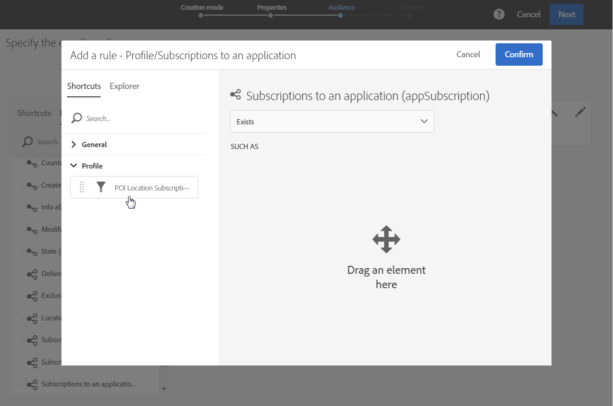
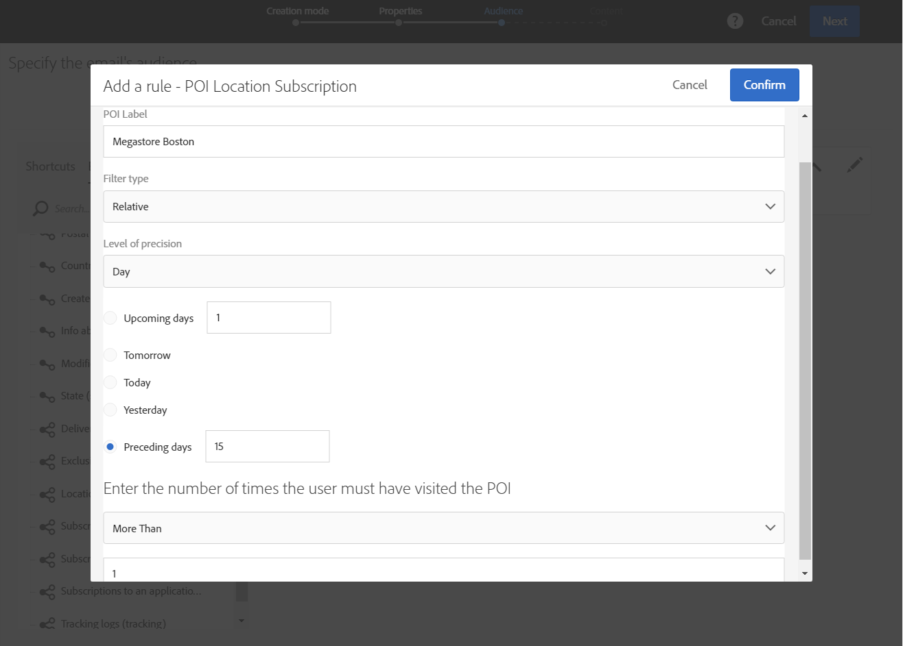
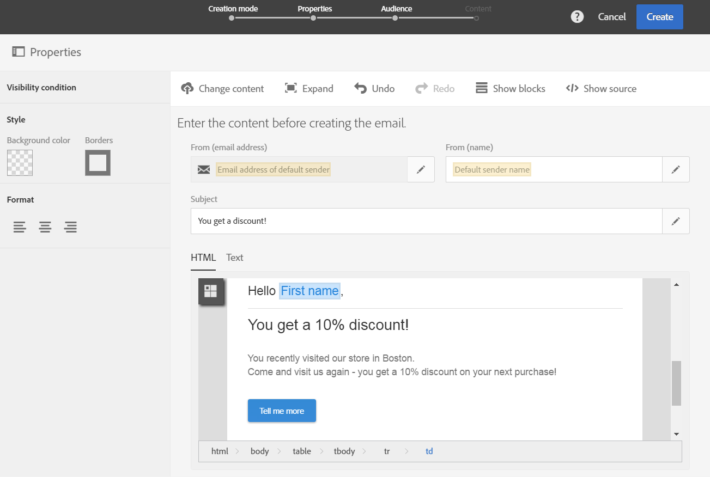

# 使用 Point of Interest 資料個人化 Campaign 訊息{#personalizing-campaign-messages-with-point-of-interest-data}

在Adobe Campaign中，您可以使用從行動應用程式訂閱者收集的Points of Interest資料，傳送個人化行銷訊息（例如電子郵件）給他們。

您只能對Point of Interest資料使用標準傳遞做出反應。 [異動訊息](../../channels/using/getting-started-with-transactional-msg.md)無法使用位置資料。

您最快的反應時間約為10分鐘。

在此情況下，您決定傳送電子郵件給過去兩週內造訪您波士頓商店的所有訂閱者。

1. 建立電子郵件行銷活動。
1. 定義傳遞的對象時，請將&#x200B;**[!UICONTROL Subscriptions to an application]**&#x200B;元素拖放到工作區中。

   

   管理對象在[定義對象](../../audiences/using/creating-audiences.md)區段中詳細說明。

1. 在&#x200B;**[!UICONTROL Add a rule - Profile/Subscriptions to an application]**&#x200B;視窗中，將&#x200B;**[!UICONTROL POI Location Subscription]**&#x200B;元素拖放到工作區中。

   

1. 在&#x200B;**[!UICONTROL Add a rule - POI Location Subscription]**&#x200B;視窗中，輸入您要使用之地標的標籤。

   

1. 在 **[!UICONTROL Filter type]** 欄位中，選取 **[!UICONTROL Relative]**。
1. 核取&#x200B;**[!UICONTROL Preceding days]**&#x200B;選項，並在對應的欄位中輸入&#x200B;**[!UICONTROL 15]**。
1. 定義使用者必須已造訪興趣點的次數。
1. 按一下&#x200B;**[!UICONTROL Confirm]**&#x200B;以儲存您的對象。

   

1. 新增內容至您的電子郵件。

   

1. 確認建立活動以檢視電子郵件的控制面板。
1. 傳送您的訊息。

包含10%折扣優惠的電子郵件將傳送給以下訂閱者：

* 過去兩週內至少造訪過您位於波士頓的店舖一次。
* 造訪期間至少將行動應用程式置於前景一次。

**相關主題：**

* [建立電子郵件](../../channels/using/creating-an-email.md)
* [定義內容](../../designing/using/personalization.md#example-email-personalization)
* [傳送訊息](../../sending/using/confirming-the-send.md)
