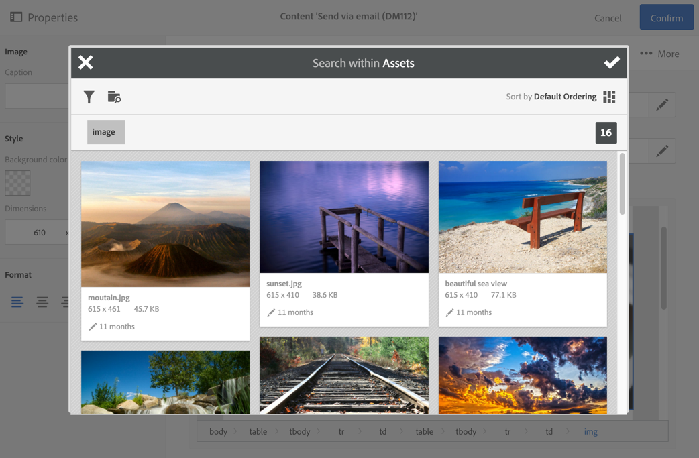

# 使用 Campaign 與 Assets 核心服務{#working-with-campaign-and-assets-core-service}

將Assets核心服務或Assets on Demand （取決於Adobe Experience Cloud環境的設定）與Adobe Campaign整合，可讓您在Adobe Campaign電子郵件和登陸頁面中，使用Adobe Experience Cloud內共用的任何資產。

與Assets核心服務的整合限製為[功能管理員](../../administration/using/users-management.md#functional-administrators)。

從Adobe Experience Cloud共用的資源可用於您的電子郵件和登入頁面，如下所示：

1. 編輯電子郵件或登入頁面的內容時，請移至影像區塊，然後透過內容功能表選取&#x200B;**[!UICONTROL Image shared from Adobe Experience Cloud]**。

   

1. 在開啟的選取範圍視窗中，選取影像，然後確認。

   

然後插入影像。 現在可以根據需要個人化傳送並傳送。

**相關主題：**

* [Assets和共用](https://experienceleague.adobe.com/docs/core-services/interface/assets/experience-cloud-assets.html)
* [內容編輯器](../../designing/using/personalization.md#example-email-personalization)
