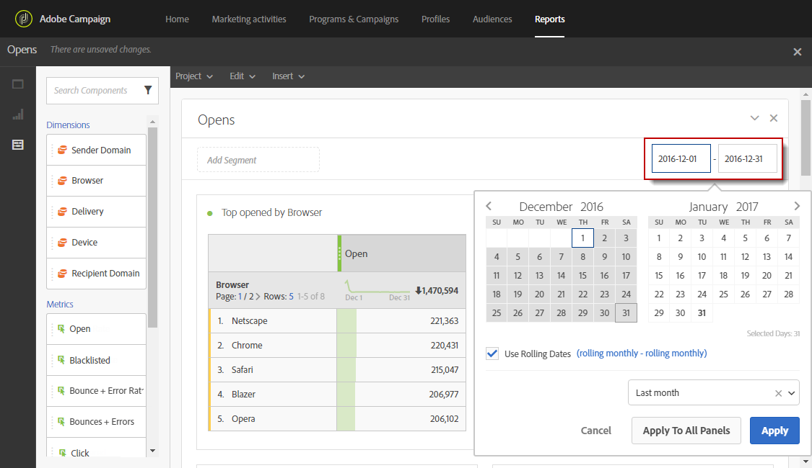

# 定義報告期間{#defining-the-report-period}

>[!NOTE]
>
>資料報表僅提供過去三年的資料。 如需資料保留期的詳細資訊，請聯絡Adobe顧問或您的技術管理員。

在開始或存取報表之前，您必須套用時段。 您可存取報表右上方的指定期間。

依預設，對於行銷活動或方案，篩選期間設定為方案或行銷活動的開始和結束日期。 對於傳遞，開始日期對應於傳送日期，結束日期對應於傳送日期加7天。

若要修改篩選，請選取開始日期和期間，或使用預先設定的期間，例如上週、兩個月前等。

套用或修改篩選器時，報表會自動更新。 選取的報告期間將控管該期間發生的事件，而不是在間隔中建立的傳遞的整組資料，例如，如果傳遞從一月一日到五日執行，而報告期間是一月一日到二日，則您可能會看到部分資料。 這可能會影響開啟/點按計數，因為即便在傳送後一個月，開啟或點按也可能會發生。

